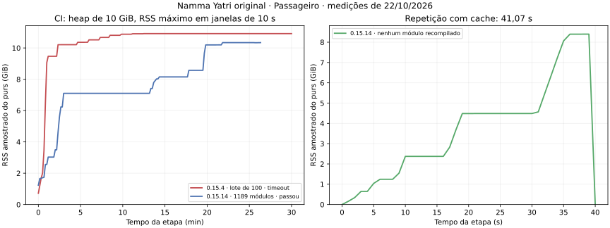

# Diagnóstico do frontend histórico — issue #1

Base: `passageiro-pt-br`, commit `2c0506ab5c0306d7a94049304d676b8f4fbfc9b9`.
Data: 22/10/2026. Fontes PureScript, componentes PrestoDOM, telas, navegação,
FFI e backend brasileiro devem permanecer intactos durante este diagnóstico.

## Resultado confirmado

**O frontend original do passageiro compilou integralmente: 1.189 módulos,
incluindo `Flow` e `Main`, geração JavaScript e saída zero.** O
[CI 39705578513](https://github.com/luizamedice-glitch/namma-yatri-br./actions/runs/39705578513)
usou Node 18.20.8, Spago 0.21.0 e a correção pontual do compilador PureScript
**0.15.14**, sem mudar os pacotes ou as fontes do aplicativo.

- Sem cache de compilação: **26min27,21s**, pico RSS **10.843.656 KiB (10,34 GiB)**.
- Repetição: **41,07s**, **nenhum módulo recompilado**, pico RSS **8.804.840 KiB**.
- Os **1.189 hashes de fontes** são idênticos entre o histórico 0.15.4, o teste
  local 0.15.14 e esse CI. O manifesto agregado é
  `a8edd26f3a3cf668487a982b8c9b20314934cd9603d3f0065c8b68d7833c59b3`.
- Configuração completa validada: runner hospedado com aproximadamente **16 GiB
  de RAM**, heap `-M10g`, uma capability GHC (`-N1`). Não foi contratado runner pago.
- O [CI final 39709751955](https://github.com/luizamedice-glitch/namma-yatri-br./actions/runs/39709751955)
  restaurou o cache, repetiu duas verificações completas e executou o comando
  npm original com PSA: **saída zero, zero erros, 43,28 s**. Os manifests e
  scripts npm são byte a byte idênticos aos originais.



O gráfico usa RSS por processo. Na primeira comparação, os tamanhos de lote
são diferentes e não constituem benchmark de CPU; os logs completos preservam
as amostras por segundo. O cache reduz o tempo, mas ainda carrega metadados
volumosos das interfaces compiladas.

O resultado é de compilação PureScript. APK, inicialização Android, integração
com backend e fidelidade visual à Play Store não foram validados nesta issue.
As interfaces históricas foram preservadas pelo código; não houve recriação de telas.

## Ferramentas e reprodução

Para reproduzir o histórico, usar Node **18.20.8**, PureScript **0.15.4**, Spago **0.21.0**, Python 3,
GNU time (`time` no Debian/Ubuntu), Git e `procps`. O pacote histórico
`hyper-purescript@0.0.25` instala o executável `fastpurs`; nesta instalação ele
reportou **0.15.15**, portanto não serve como prova de uso do `purs` 0.15.4.
O script verifica as versões dos executáveis efetivamente encontrados no PATH.

```bash
npm install --global --ignore-scripts=false purescript@0.15.4 spago@0.21.0
cd Frontend/ui-customer
npm install --legacy-peer-deps --ignore-scripts=false
GHCRTS='-N1 -M512m' spago -j 2 install
cd ../..
python3 Frontend/scripts/diagnose-purescript.py --heap 2500m --label cold
```

O diagnóstico não instala nem atualiza dependências, não limpa `output` e não
remove módulos. Registra grafo, hashes das fontes resolvidas, comando completo,
logs, `time -v`, estatísticas GHC e amostras de RSS/cgroup por segundo em
`purescript-diagnostics/<label>/`. Cada label precisa ser nova, evitando
sobrescrever evidências. Para executar sem cache anterior, usar um novo checkout;
para medir retomada, repetir com outra label no mesmo checkout.

```bash
python3 Frontend/scripts/diagnose-purescript.py --heap 5500m --mode staged --label staged
python3 Frontend/scripts/diagnose-purescript.py --heap 5500m --label incremental
python3 Frontend/scripts/diagnose-purescript.py --heap 5500m --mode module --label strings
```

`staged` organiza alvos em ordem topológica, priorizando os fechos de
`Resources.LocalizableV2.Strings` e `Common.RemoteConfig.Utils`. Cada chamada
inclui somente os alvos do lote e suas dependências transitivas, sem acumular
alvos anteriores sem relação. `--batch-size` limita novos alvos, não o tamanho
do fechamento nem o consumo de memória. O workflow usa 25 alvos; os módulos
HomeScreen.Controller, HomeScreen.View, Flow, Main e Development.Passenger
ficam isolados. `plan.json` registra o plano antes da execução.

A estratégia antiga de prefixos cumulativos foi substituída após a auditoria
em [RELATORIO-AUDITORIA-LOTES.md](RELATORIO-AUDITORIA-LOTES.md). Não há mais
Spago completo automático ao final de `staged`. O workflow faz a verificação
completa separadamente, com `--require-cache`, que interrompe se encontrar
recompilação inesperada. Falha interrompe os próximos lotes; não é convertida
em sucesso. `--warmup-module Nome` prioriza o fecho de outro módulo na ordem;
`--no-default-warmup` remove as prioridades padrão.

O workflow limita cada chamada a 600 s, ausência de saída a 300 s e RSS
amostrado a 12 GiB. Publica RSS e tempo a cada 30 s. Ausência de saída não
comprova deadlock: o limite existe para exigir investigação antes de outra
espera longa. O cache é verificado pelo compilador, não substitui código novo
por um bundle antigo. A opção `cache_run_id` recupera uma referência completa
com job PureScript bem-sucedido e exige que o cache solicitado esteja presente.

`module` compila somente o módulo escolhido e seu
fecho transitivo: é um experimento, não valida o aplicativo inteiro.
`--codegen corefn` permite separar experimentalmente geração JS das fases
anteriores; CoreFn sozinho também não constitui entrega do frontend.

`--timeout-seconds` limita cada invocação (padrão 1800 s), registra saída 124 e
interrompe seu grupo de processos, incluindo filhos que sobrevivam ao Spago.
SIGINT/SIGTERM também produzem resumo e limpeza. `--time-bin` permite apontar para GNU time
instalado fora de `/usr/bin`. `--app motorista` seleciona o outro frontend.

## Interpretação da memória

`-M2500m` é um limite de **heap GHC** de 2.621.440.000 bytes. Não é um limite do
V8; aumentar `NODE_OPTIONS` não o altera. RSS inclui memória além do heap.
`memory.current` também inclui cache de arquivos e outros processos no cgroup;
`memory.peak` pode anteceder o teste. Não tratá-los como heap do compilador.
Comparar `memory.events` antes/depois para identificar OOM do sistema.

`-N1` limita as capabilities GHC. O `-j` do Spago não é uma opção de jobs do
`purs compile`; não existe essa opção na ajuda do compilador 0.15.4. O cap do
Spago é 512 MiB; argumentos RTS explícitos dão ao compilador o heap selecionado.
O medidor rejeita heap acima do orçamento físico/cgroup, reservando o maior
entre 1 GiB e 20% do limite. Isso não garante disponibilidade se outros processos
estiverem consumindo RAM. O teste `--heap 10g` foi rejeitado corretamente nesta
máquina de 8 GiB, antes de iniciar o compilador. O workflow usa runner padrão hospedado, sem contratar
runner pago nem implantar serviços. Conferir a RAM real antes de aumentar heap.

## Resultados medidos

Evidência prévia: o [run 39689855720](https://github.com/luizamedice-glitch/namma-yatri-br./actions/runs/39689855720)
falhou no passageiro em `Resources.LocalizableV2.Strings` (659/1189), com heap
2.500 MiB. O runner tinha aproximadamente 15 GiB de RAM e 3 GiB de swap: essa
falha veio do cap artificial, não prova insuficiência física desse runner.

Reprodução local, Linux x86_64, limite cgroup **8 GiB**, host 9,7 GiB, sem swap:

| Experimento | Resultado | Tempo | Pico RSS | Observação |
|---|---|---:|---:|---|
| Spago completo, `-N1 -M2500m` | Falhou em 659/1189 | 4min11,32s | 2.720.052 KiB | Heap exhausted; saída 1 |
| Lotes simples, primeiros 400 módulos | 4 etapas passaram | 3,01 / 6,02 / 12,05 / 8,03 s¹ | até 663.132 KiB | Cache gravado |
| Lote simples seguinte, heap 5500m | Interrompido manualmente | 15min08,72s | 5.899.688 KiB | Sem conclusão; não foi OOM |
| 100 módulos em saída separada, frio | Passou | 3,03s | 82.852 KiB | Cache novo |
| Mesmos 100 módulos, quente | Passou | 0,16s | 64.800 KiB | Retomada confirmada |
| Strings original, fecho de 369 módulos, heap 5500m | **Passou** | 1min05,34s | 3.988.860 KiB | 17 módulos recompilados, demais em cache |
| Common.RemoteConfig.Utils original, fecho de 380 módulos, heap 6500m | **Passou** | 2min08,66s | 5.428.820 KiB | 22 módulos recompilados, demais em cache |
| CI 0.15.14, frontend completo, heap 10g | **Passou: 1189/1189** | 26min27,21s | 10.843.656 KiB | Checkout sem cache de compilação |
| CI 0.15.14, repetição completa | **Passou: 0 recompilados** | 41,07s | 8.804.840 KiB | Cache validado pelo compilador |

¹ Tempos medidos pelo sampler, que tem resolução de aproximadamente 1 s;
as demais durações são de GNU time. Experimentos curtos paralelos ocorreram
durante parte do primeiro teste por lotes; não usar esses tempos para comparar CPUs.

Os dois módulos críticos foram compilados com geração **JavaScript** real,
produzindo `externs.cbor` e `index.js`, com saída zero e fontes originais intactas.
A validação completa posterior está registrada nas duas linhas de CI. Os êxitos
isolados anteriores, por si sós, não haviam demonstrado a compilação do aplicativo.

Na máquina local de 8 GiB, o teste completo 0.15.14 com heap de 6500 MiB chegou
ao módulo 1177/1189 (`Screens.HomeScreen.Controller`) e foi encerrado pelo
watchdog de 15 minutos, com saída 124. Foi um limite do teste, **não erro de tipo
nem OOM do kernel**. Uma retomada por etapas preservou sete checkpoints até o
prefixo de 891 módulos; a etapa seguinte foi interrompida após o CI completo
passar. Esses testes locais não são apresentados como um build completo.

No CI completo, o GHC mediu residência máxima de **7.650.447.200 bytes** e
aproximadamente **1,82 TB de alocações cumulativas**: esse total não é RAM
residente. GC consumiu 963,440 s de 1.585,800 s (cerca de 61%). A compilação
continua pesada, apesar de viável no runner validado. Não foi determinado o
menor heap possível nem garantida a conclusão integral em uma máquina de 8 GiB.

GHC: 113.591.887.880 bytes alocados cumulativamente (não residentes), residência
máxima 2.578.889.552 bytes, GC 204,048 s de 250,640 s; produtividade 18,6%.
Contadores `oom` e `oom_kill` permaneceram zero. Foram gerados 657 diretórios de
módulos, mas não existia `output/cache-db.json` após a falha.

O módulo `Resources.LocalizableV2.Strings` tem 1.885 linhas, importa oito idiomas,
opera sobre `Keymap` com **1.790 campos**, usa constraints `Cons`, `Lacks`,
`Newtype` e proxies em uma grande seleção de traduções. Seu fecho transitivo tem
369 dos 1.189 módulos. Reduções temporárias por declaração compilaram o prefixo
até `getStringV2`, mas `getProxy` sozinho atingiu o limite de tempo de 120 s com
heap de 1500 MiB. Isso localiza custo relevante na grande seleção de traduções;
não identifica sozinho a função interna do compilador que retém memória.

Depois de pré-compilar Strings, o build completo avançou até outro módulo sem
saída: `Common.RemoteConfig.Utils`, com 626 linhas, decodificações genéricas de
registros de configuração por cidade e tipos aninhados. Ele passou em processo
separado. Portanto, **659 é um contador de tarefas iniciadas, não prova de que
apenas o último módulo impresso esteja consumindo memória**. A ordem variou
entre CI e execução local.

No [compilador 0.15.4, Make.hs](https://github.com/purescript/purescript/blob/v0.15.4/src/Language/PureScript/Make.hs),
`make` cria uma tarefa com `fork` para cada módulo a recompilar. `-N1` limita
capabilities, mas não torna essas tarefas uma fila de um módulo. Manter dois
pontos de alta memória em processos separados reduz a sobreposição de estados
do compilador. Os lotes controlam quantos módulos novos entram em cada processo;
não é uma opção fictícia de concorrência passada ao `purs`.

O perfil de heap `-hT -i1` do fecho de Strings, com saída CoreFn e cap 1200 MiB,
teve amostra de 1.202.199.712 bytes: mapas `Data.Map.Internal.Bin` somaram
572.923.296 bytes, `THUNK_1_0` 290.529.024 bytes e tipos `RCons` 83.576.080 bytes.
Esse experimento foi interrompido manualmente após 7min57s; não passou nem
demonstrou erro final de tipo. O perfil aponta para estruturas Haskell e tipos
de registros, sem atribuir um cost centre preciso. Trocar a saída por CoreFn
não é a solução incorporada ao build.

Também foram testados acessos diretos e separação de função em cópias de
diagnóstico. Não resolveram o build completo nos limites testados e **não foram
incorporados**. Nenhum arquivo de tela ou tradução foi substituído por essas cópias.

O [run 39696751670](https://github.com/luizamedice-glitch/namma-yatri-br./actions/runs/39696751670)
com `-M10g` terminou cancelado após aproximadamente 40 minutos, ainda no grupo
de tarefas 658–659. O log não demonstra sucesso nem Heap exhausted nessa
tentativa. Aumentar o heap sozinho não ficou validado como solução.

## Alterações e limites

### Correção pontual avaliada no compilador

O [changelog oficial da versão 0.15.14](https://github.com/purescript/purescript/releases/tag/v0.15.14)
documenta dois problemas diretamente relevantes:

- [#4517](https://github.com/purescript/purescript/pull/4517): módulos demais
  intercalados, especialmente com `-N1`, e retenção de memória dos módulos
  compilados com avisos. O código novo usa `QSem` e força resultados/avisos.
- [#4521](https://github.com/purescript/purescript/pull/4521): crescimento de
  memória do passe CSE em arquivos grandes. A correção troca `Data.Map` por
  `Data.Map.Strict`; o código 0.15.4 usa o mapa preguiçoso. Isso é compatível com
  a predominância de mapas e thunks observada no perfil, sem atribuir toda a
  diferença a apenas um commit.

A comparação usa **0.15.14**, primeira versão com essas correções, em outro
checkout e outro `output`. Os **1.189 hashes de fontes PureScript coincidem**
entre 0.15.4 local, CI inicial e 0.15.14 local. Node, Spago, package-set,
dependências e fontes de ambos os aplicativos permanecem iguais. Não foi
executado `npm audit fix` nem atualização geral de pacotes.

O medidor aceita `--compiler-version 0.15.14` e exige essa versão real no PATH.
O workflow agora seleciona explicitamente essa correção e separa caches por
versão do compilador; a opção 0.15.4 continua disponível para diagnóstico.
A compilação 0.15.14 com heap de 6500 MiB gerou `Services.API`, enquanto o
mesmo módulo isolado na 0.15.4 atingiu o limite de 300 s. O CI com heap de 10 GiB
depois concluiu todas as fontes, sem cache, e repetiu a verificação com cache.

```bash
npm install --global --ignore-scripts=false purescript@0.15.14 spago@0.21.0
# Em máquina com pelo menos a configuração validada de 16 GiB:
python3 Frontend/scripts/diagnose-purescript.py --compiler-version 0.15.14 --mode full --heap 10g --label fixed
python3 Frontend/scripts/diagnose-purescript.py --compiler-version 0.15.14 --mode full --heap 10g --label warm
# Dentro de Frontend/ui-customer, no mesmo ambiente de 16 GiB:
GHCRTS='-N1 -M10g' npm run compile:purs
```

O histórico do compilador 0.15.4 permanece reproduzível com os comandos da
primeira seção. Os binários oficiais Linux usados na comparação foram obtidos
dos releases do projeto, com SHA-256:

| Versão | SHA-256 do executável nativo |
|---|---|
| 0.15.4 | `e6ced6356331ea9dec89f3ac3fb1c022224ca558ca6c34f65ff33f39c6cd7ff1` |
| 0.15.14 | `68b5b9a0f71e07820d11bfcaa434f2d824b1ec0256ac1aecaea336c4ab0102aa` |

### Escopo preservado

`Frontend/build-reports/issue-1/measurements.json` registra métricas e a auditoria
de escopo. Nenhuma alteração foi feita em `Frontend/ui-customer/src`,
`Frontend/ui-driver/src`, `Frontend/ui-common`, `Frontend/android-native`,
`Frontend/packages.dhall`, `brasil/backend` ou `Backend`. As dependências
declaradas, licenças, autores e scripts npm originais foram preservados.

- Preservados os scripts npm originais. `--censor-warnings` pertence ao PSA
  0.8.2 e é válido quando o Spago chama esse frontend; o `purs` direto não o
  aceita. O medidor usa `spago -P` sem essa opção para capturar os avisos reais.
  A rejeição isolada do argumento pelo `purs` não é tratada como defeito do app.
- Adicionados medidor e workflow isolado, sem atualização de manifests de
  dependências, package-set, código de telas ou backend.
- O workflow compila o ref efetivo da execução/PR, preserva caches mesmo após
  falha e publica logs inclusive quando o build falha. Os hashes documentam
  dependências históricas referenciadas por branches móveis; não se afirma
  reprodutibilidade byte a byte sem lock dos commits externos.
- `corefn`, um módulo isolado, outputs parciais ou bundles históricos já
  existentes não comprovam build completo nem APK operacional. Empacotamento
  Android, comparação visual e integrações de execução estão fora desta issue.

O novo workflow publica grafo, hashes, logs, estatísticas GHC, GNU time e séries
RSS como artefatos, inclusive em falhas. O artefato da compilação completa é
[purescript-memory-passageiro-0.15.14-1](https://github.com/luizamedice-glitch/namma-yatri-br./actions/runs/39705578513/artifacts/12395184363).
A validação adicional do comando npm original com PSA **passou** no
[artefato final](https://github.com/luizamedice-glitch/namma-yatri-br./actions/runs/39709751955/artifacts/12396094217).
As verificações estáticas `python3 -m py_compile` e `actionlint` também passaram.
O motorista teve dependências preparadas, mas seu frontend completo não foi
compilado nesta execução. O workflow implementa seletor de aplicativo em
`workflow_dispatch`; a execução manual depende de o arquivo também estar no
branch padrão do GitHub. PRs e pushes em `passageiro-pt-br` têm execução automática.
